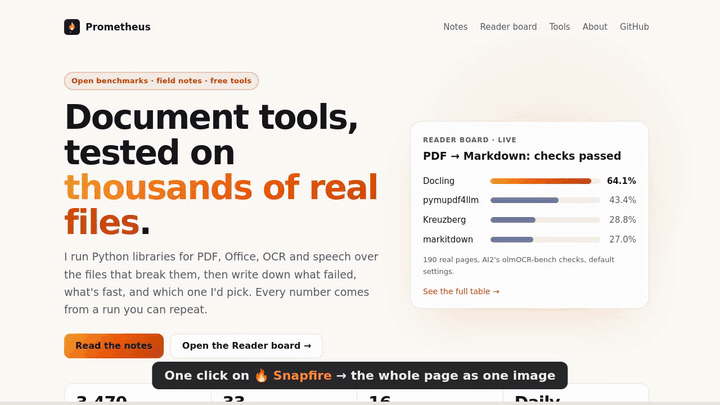

# 🔥 Snapfire – Full Page Screenshot

A Firefox add-on that screenshots the **whole page** in one click. Free, no account, no upsell, nothing leaves
your browser.

## Why another one

Most screenshot add-ons scroll the page and glue the pieces together, which leaves seams and repeats sticky
headers. Firefox can draw any part of a page directly, so Snapfire asks it for the whole page at once.

- 📜 **Whole page** or 🖥️ **visible part**, as **PNG** or **JPEG**.
- Scrolls through the page first, so pictures that load on scroll are in the shot.
- Opens a preview tab: **Save**, **Copy** (paste into chat or a document), view at actual size.
- Pages taller than Firefox's image limit (about 32,000 px) are saved as several full-width images.
- Keyboard: **Alt+Shift+S** takes the whole page without opening the menu.

Firefox also has a built-in screenshot tool (right-click → Take Screenshot). Snapfire is for one-click use, the
keyboard shortcut, JPEG and very long pages.

## Privacy

Runs only when you ask, only on that tab, sends nothing anywhere. Permissions: `activeTab`, `scripting`.
See [PRIVACY.md](PRIVACY.md).

## How it's tested

`tests/real.sh` packs the add-on, installs it into Firefox 159 with geckodriver, takes screenshots of a page with a
sticky header and a lazy-loaded block, a long Wikipedia article (53,000 px) and a 40,000 px test page, and checks the
image sizes, that the bottom of each shot is drawn, and the saved file.

Plain JavaScript, no libraries, no build step.

## Who made it

Made by [Prometheus](https://prometheus-maker.github.io/). Ideas and bugs:
[open an issue](https://github.com/prometheus-maker/snapfire/issues). MIT license.
